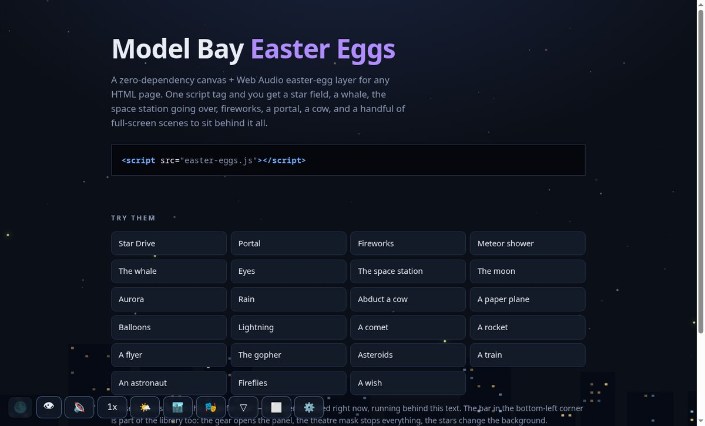
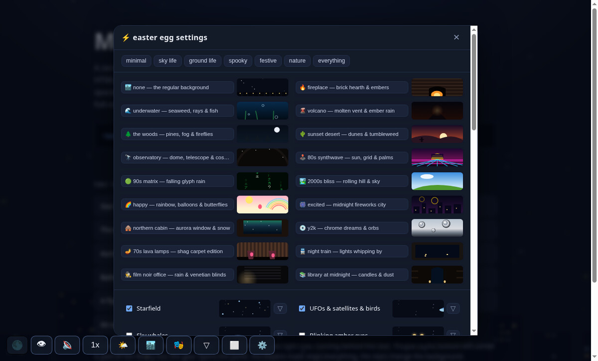
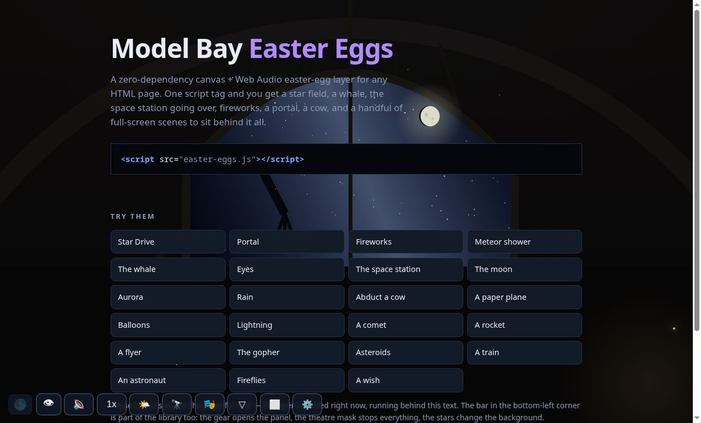

# Model Bay — Easter Eggs

A zero-dependency canvas + Web Audio easter-egg layer for any HTML page.



**Try it live:** [200plat.github.io/model-bay-eggs](https://200plat.github.io/model-bay-eggs/)

Drop in:
```html
<script src="easter-eggs.js"></script>
```

Everything happens with no HTML/CSS requirements: fixed canvas behind/on top, auto-created toolbar bottom-left, auto-created canvas top-right, twinkling stars, flyers, sky events, sounds.

## Files

- `easter-eggs.js` — the whole library
- `bare.html` — truly minimal page that includes only eggs.js (open in browser to watch "nothing" happen)
- `demo.html` — a settings/museum page with one button per egg

## Public API (`window.ModelBayEggs`)

```js
ModelBayEggs.setGPU(0..100);        // fake load → stars speed up
ModelBayEggs.hyperspace();          // Star Drive rainbow for 20s
ModelBayEggs.toggleMusic();         // mute / unmute
ModelBayEggs.toggleSpeed();         // 1x ↔ 10x event rate
ModelBayEggs.openSettings();        // open egg panel
ModelBayEggs.festive();             // returns 'none' | 'christmas' | 'halloween' | 'newyear'
ModelBayEggs.setFestive(mode);      // set festive mode
ModelBayEggs.scene;                 // returns current scene id ('none' | 'fireplace' | ...)
ModelBayEggs.setScene('fireplace'); // full-screen background scene (mutually exclusive)
ModelBayEggs.triggerAbduction / triggerWhale / triggerComet / triggerRocket / triggerRainbow /
ModelBayEggs.triggerFireworks / triggerGopher / triggerBalloon / triggerLightning /
ModelBayEggs.triggerTrain / triggerTrainPass / triggerEyes / triggerShower / triggerISS /
ModelBayEggs.triggerMoon / triggerAurora / triggerTrain / triggerAstronaut / triggerPortal /
ModelBayEggs.triggerRain / triggerPumpkin / triggerPaperPlane / triggerAsteroids / triggerBatSwarm /
ModelBayEggs.triggerComet / triggerFireflies / (and more)
```

## Controls on page load

- **Konami code** `↑↑↓↓←→←→BA` → 20s Star Drive; twice within 5s → Portal
- **Bottom-left toolbar**: 👁 show/hide icons · 🔇 music · 1x/10x warp · theme cycle · 🎭 hide/show all effects · ▲▽ on-top/behind · 🎄 festive · **🖼️ scenes cycle** · ⚙️ settings panel


- **⚙️ settings panel**: preset themes (minimal, sky life, ground life, spooky, festive, nature, everything) + per-egg toggle + ▲/▽ layer button + animated previews per row
- **Scenes** (one at a time): 🔥 fireplace · 🌊 underwater · 🌋 volcano · 🌲 the woods · 🌵 sunset desert · 🔭 observatory · 🕹️ 80s synthwave · 🟢 90s matrix · 🏞️ 2000s bliss · 🌈 happy · 🎆 excited · 🛖 northern cabin · 💿 y2k · 🪔 70s lava lamps · 🚆 night train · 🕵️ film noir office · 📚 library at midnight — full-screen static-cached backgrounds with their own live ambient animation, drawn behind the UI
- **Scene ambience** (off by default): ⚙️ → toggle — per-scene synthesized soundscapes (fire crackle, forest crickets, synthwave bass, train clacks…). No assets, all Web Audio
- **Real moon phase** in the supermoon and all moon-bearing scenes (current lunation computed from date, no network)
- **Latitude-driven sunrise/sunset glow** — set your latitude in ⚙️ to make the horizon light track the real twilight hours (default 40°N)
- **scene-of-the-day** toggle in ⚙️ — one seeded scene per day, opt-in
- **analog static** egg (off by default): silent burst of broadcast snow, occasional frame tear
- **the skyline cat** — occasionally loafs on a rooftop and blinks at you
- **the cow gaze** — every so often the cow stops and stares at you for three seconds
- **the telescope cat** — petit by clicking the kitty loafed beneath the observatory telescope (it purrs)

## Scenes

Full-screen backgrounds with their own live animation, drawn behind the page.
One at a time, and the visitor picks from the panel.



## Notes

- `prefers-reduced-motion` disables animation
- `localStorage` keys: `modelbay:*` (plain key: value strings)
- Audio is muted until first user gesture; master volume is deliberately low (0.055)
- No dependencies, no build step, no images
